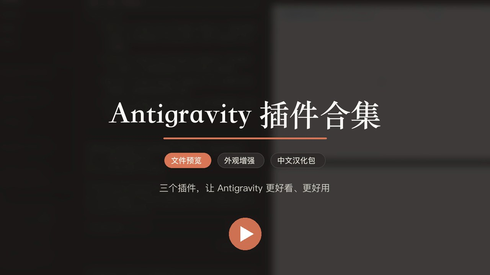
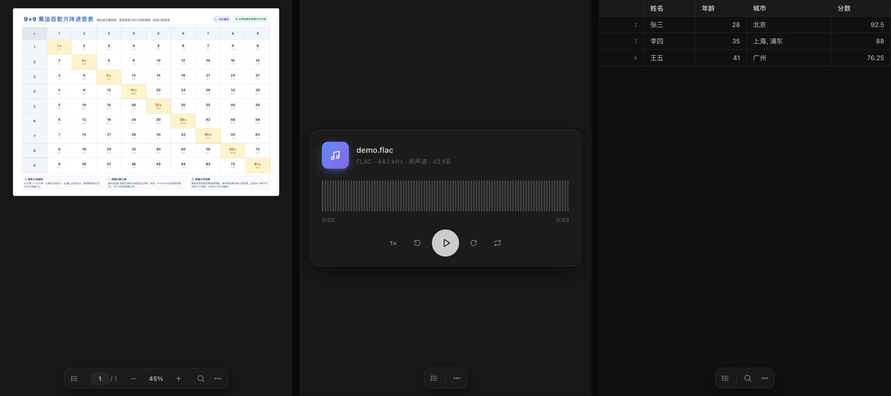
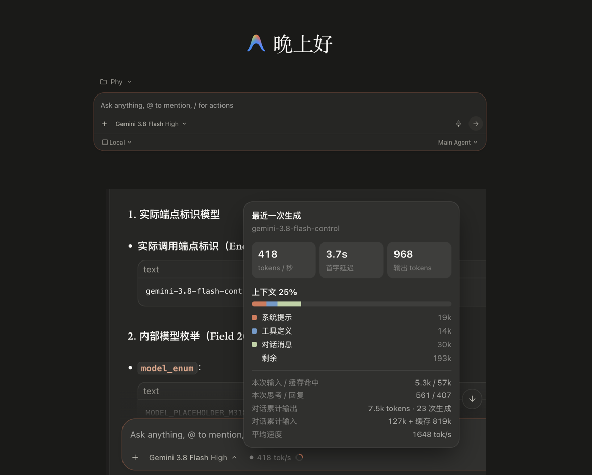

# Antigravity 插件合集

给 Google Antigravity 桌面版用的三个插件，装上即用，不改动 Antigravity 本身，随时可以卸载。

| 插件 | 作用 |
| --- | --- |
| **document-preview** 文件预览 | 在 Antigravity 里直接预览 PDF、Word/PPT/Excel/WPS、CSV 表格、相机 RAW/HEIC/PSD 图片、各种音视频、字体和压缩包 |
| **claude-style** 外观增强 | Claude 风格配色与全局衬线字体（可自定义强调色和背景色调）、TPS / 上下文用量、用量额度、Git 面板（暂存 / 拉取 / 分支 / PR）、“打开方式”菜单 |
| **antigravity-zh** 中文汉化包 | 把 Antigravity 的界面（侧边栏、设置、菜单、命令、提示）翻译成中文，不碰对话内容和代码；默认开启，可随时关闭 |

> 仅支持 **macOS**。与 Google、Antigravity、Anthropic 官方无关。

[](https://cdn.jsdelivr.net/gh/Eugene20071112/antigravity-plugins@media/antigravity-plugins-promo.mp4)

▶ [观看宣传视频（87 秒）](https://cdn.jsdelivr.net/gh/Eugene20071112/antigravity-plugins@media/antigravity-plugins-promo.mp4)

## 一键安装

打开「终端」，粘贴这一行回车：

```bash
curl -fsSL https://raw.githubusercontent.com/Eugene20071112/antigravity-plugins/main/install.sh | bash
```

装完后插件会被 Antigravity 自动加载，不用重启。如果没生效：Antigravity 左侧 **Customizations → Installed**，把插件启用即可。

只装其中几个（例如不要汉化包）：

```bash
curl -fsSL https://raw.githubusercontent.com/Eugene20071112/antigravity-plugins/main/install.sh | bash -s document-preview claude-style
```

再运行一次同样的命令就是**更新**（旧版本会自动备份到 `~/.gemini/backups/`）。

### 可选依赖（文件预览）

| 依赖 | 用来 | 安装 |
| --- | --- | --- |
| LibreOffice | 预览 Word / PPT / Excel / WPS / Pages 等 Office 文档 | `brew install --cask libreoffice` |
| ffmpeg | 播放 MKV / AVI / WMV / AIFF / WMA 等需要转换的音视频 | `brew install ffmpeg` |

PDF、CSV、图片、MP3/FLAC 等不需要任何依赖。安装脚本会检查并提示。

## 文件预览 document-preview



- 在对话或文件树里点开文件，会自动在右侧用插件打开；PNG/JPG/MP4 等 Antigravity 自带能看的格式仍交给官方查看器
- 再次点击已打开的同一个文件链接会刷新预览，重新读取文件内容。
- PDF：基于 Mozilla pdf.js，可选中文字、⌘F 查找、触控板双指缩放、页面缩略图、夜间阅读
- Office / WPS：用 LibreOffice 转成 PDF 后显示（首次几秒，之后有缓存）
- CSV / TSV：表格视图，表头固定、可筛选，自动识别 GBK 编码的中文表格
- 图片：HEIC、TIFF、PSD、相机 RAW（DNG/CR2/NEF/ARW…）等，可拖动、缩放、旋转
- 音视频：自制播放器，音频带波形；不支持的编码自动用 ffmpeg 转换（原文件不变）
- 字体样张、压缩包文件列表
- 从 Overview → Plugins → 文件预览 打开时，列出**本对话用到的文件**和工作区文件，可搜索、按类型筛选

## 外观增强 claude-style



- **配色与字体**：暖米白浅色 / 暖炭灰深色，跟随 Antigravity 的深浅主题；全局使用 Claude 风格衬线字体（可改为只有回复用衬线）；强调色（7 种预设或任意自定义颜色）和背景色调（暖灰 / 中性 / 纯黑纯白）都可以自己选；输入框与消息气泡重新设计
- **用量额度**：侧边栏“设置”旁直接显示 Gemini 和 Claude·GPT 的 5 小时剩余额度（周额度快用完时自动切换），点击查看 5 小时和每周额度及重置时间；可在设置里关闭
- **界面语言**：跟随系统语言（中文 / 英文）；装了汉化包时显示中文
- **TPS / 上下文用量**：模型选择器旁显示上一次生成的回复接收速率估算和上下文占用圆环。回复速率使用非思考输出 / 流式接收时长；短于 0.5 秒的流式记录不参与测速，生成中不使用字符数猜测 token。点开（⌘⌥U）可查看延迟、输出与思考用量、上下文和累计统计；模型一栏只使用后端返回标识。后端标识不能验证底层权重或解释 control 等后缀。上下文为最近一次请求开始时的估算，上限从该次生成记录读取。
- **Git 面板（⌘⇧G）**：按文件暂存 / 取消暂存 / 丢弃、就地看 diff、提交 / 提交并推送、拉取、切换和新建分支、创建 PR（装了 `gh` 时用 `gh pr create --web`，否则打开 GitHub/GitLab 的新建页面）
- **打开方式（⌘⌥E）**：在 VS Code、Cursor、Zed、Xcode、Finder、终端、iTerm、Warp 等中打开当前工作区（只列出你装了的应用）
- 顶栏滑杆按钮里可以开关配色、衬线字体、中文宋体、宽版阅读、用量显示，调整回复字号
- 修复：菜单自动聚焦时会无故弹出 “Click to Open Docs” 之类提示的问题
- 新对话页问候语；Overview → Documents 里打不开的 PDF 等文件改用文件预览插件显示（需同时安装 document-preview）

### 它是怎么工作的

Antigravity 启动时自带一个本机调试端口（`DevToolsActivePort`）。claude-style 的后台进程通过它把样式和功能注入 Antigravity 窗口，并通过私有通道与页面通信，不开放任何网络端口。关闭插件，所有改动立刻撤销；Antigravity 更新后依然可用（如果官方大改界面，个别样式可能需要插件跟进更新）。

## 中文汉化包 antigravity-zh

- 安装后**默认开启**：Antigravity 的侧边栏、设置、菜单、命令面板、按钮提示等界面文字变成中文，“3d / 3mo” 这类时间也会显示为“3天 / 3个月”
- 只翻译界面，不改动你的对话内容、项目名、文件名、代码和 Artifact
- 开关：顶栏滑杆按钮 → **中文界面**；或在 Customizations → Installed 里停用插件，界面立即恢复英文
- 语言联动：汉化包开启时，文件预览和外观增强插件也显示中文；关闭后它们跟随系统语言

## 卸载

```bash
curl -fsSL https://raw.githubusercontent.com/Eugene20071112/antigravity-plugins/main/uninstall.sh | bash
```

或者手动删除 `~/.gemini/config/plugins/` 下的 `document-preview`、`claude-style`、`antigravity-zh` 文件夹。

## 手动安装

下载本仓库（Code → Download ZIP），把 `plugins/` 里的文件夹复制到 `~/.gemini/config/plugins/`。

---

## English

Three plugins for the Google Antigravity desktop app (macOS):

- **document-preview** — preview PDF, Office/WPS (via LibreOffice), CSV/TSV, RAW/HEIC/PSD images, audio/video (ffmpeg for exotic codecs), fonts and archives inside Antigravity.
- **claude-style** — Claude-style colors and serif typography (custom accent and background tone), backend-reported usage, estimated reply reception rate and context usage, quota at a glance, a Git panel (stage/pull/branch/PR) and an "Open in…" menu. Follows your system language.
- **antigravity-zh** — Chinese language pack for the Antigravity UI (on by default; toggle it in the appearance menu or disable the plugin).

Install: `curl -fsSL https://raw.githubusercontent.com/Eugene20071112/antigravity-plugins/main/install.sh | bash`

Promo video (Chinese, 87 s): https://cdn.jsdelivr.net/gh/Eugene20071112/antigravity-plugins@media/antigravity-plugins-promo.mp4

MIT licensed. PDF.js is © Mozilla, Apache-2.0 (see `NOTICE`). Not affiliated with Google, Antigravity or Anthropic.
